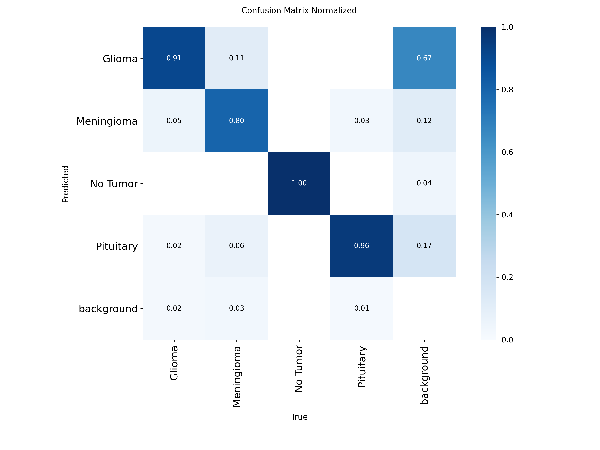
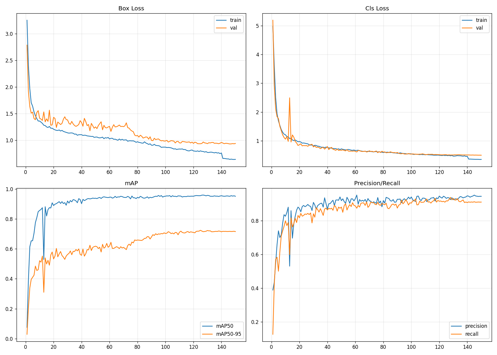
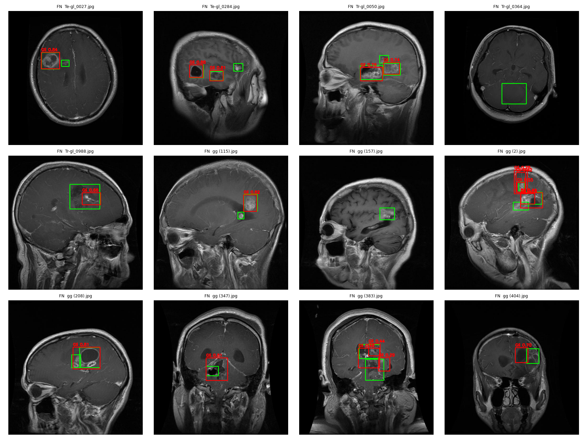

# Brain Tumour Detection with YOLO11n

An educational brain MRI object detection project built around a data integrity audit. The notebook cleans annotations, groups duplicate scans before creating new splits, trains YOLO11n from random initialization, evaluates a held-out test set, and inspects detection errors.

> **Research and education only. This model is not a diagnostic tool and must not be used to make medical decisions.**

## What makes this project useful

The main contribution is the dataset audit and evaluation setup, rather than a new detector architecture. The notebook found that many scans in the source validation set also appeared in training. It groups exact and visually similar images before splitting so duplicates stay on one side of the new train/validation/test split. It also checks folder labels against box class IDs, removes confirmed spurious boxes, and reports per-class scores and example errors.

## Results

The reported held-out test set contains 580 images and 628 labelled boxes. The reported metrics are:

| Metric | Score |
|---|---:|
| Precision | 0.950 |
| Recall | 0.918 |
| mAP@0.5 | 0.950 |
| mAP@0.5:0.95 | 0.703 |
| Macro F1 | 0.934 |

| Class | Precision | Recall | AP@0.5 | AP@0.5:0.95 |
|---|---:|---:|---:|---:|
| Glioma | 0.882 | 0.836 | 0.898 | 0.619 |
| Meningioma | 0.969 | 0.910 | 0.948 | 0.752 |
| No Tumor | 0.994 | 0.976 | 0.994 | 0.793 |
| Pituitary | 0.954 | 0.952 | 0.960 | 0.648 |

**Metric provenance:** the notebook evaluates the test split in a separate cell, but the cell that writes `results/test_metrics.json` assigns the displayed scores as constants instead of reading them from the evaluation output. Treat the JSON as a recorded result summary; rerun evaluation and verify the numbers before using them as a fresh reproduction.

## Dataset audit

The source is [MRI for Brain Tumor with Bounding Boxes](https://www.kaggle.com/datasets/ahmedsorour1/mri-for-brain-tumor-with-bounding-boxes), containing 5,249 images.

- Removed 279 spurious boxes found in Glioma and Meningioma folders, and identified one empty label file.
- Used exact MD5 and perceptual pHash comparisons to group duplicates. This reduced the data to 3,862 unique scan groups.
- Created a class-stratified, group-level 70/15/15 train/validation/test split with seed 42: 2,703 / 579 / 580 images. The notebook asserts that groups do not overlap between splits.
- Converted images to grayscale to remove colour-channel cues and re-encoded them consistently. Grayscale conversion does not address every possible dataset shortcut.

The original validation split had substantial duplicate overlap with training: 220 of 512 images (43%) had a train duplicate. The notebook reports contamination by class in its audit output.

## Error analysis

At confidence 0.25 and IoU 0.5, the test set contained 584 correct detections, 2 wrong-class matches, 42 missed boxes, and 70 false positives. Of the missed boxes, 19 had no prediction and 23 had a prediction with IoU below 0.5. Glioma accounted for 49 false positives; these included background detections, loose localization, and duplicate boxes.

## Reproduce the experiment

1. Open [`notebooks/brain-tumour-classification _notebook.ipynb`](notebooks/brain-tumour-classification%20_notebook.ipynb) in Google Colab or Kaggle and select a GPU runtime. Training from scratch on CPU is impractical.
2. Install the dependencies with `pip install -r requirements.txt`. The notebook also installs its core data-handling dependencies in an early cell.
3. Run the notebook cells in order. It downloads the dataset through `kagglehub`, prepares the audited split, trains the model, and evaluates the held-out test set. Follow Kaggle's authentication requirements if prompted.

The experiment used Python 3.12.13, PyTorch 2.10.0, Ultralytics 8.4.175, and a Tesla T4 GPU. Training used 150 epochs maximum, patience 25, batch size 16, image size 512, seed 42, and no pretrained weights. See [`results/run_config.json`](results/run_config.json) and [`results/args.yaml`](results/args.yaml) for the recorded configuration, and [`results/test_metrics.json`](results/test_metrics.json) for test metrics.

## Repository contents

- `notebooks/`: data audit, training, evaluation, and analysis workflow.
- `results/`: metrics, split manifest, run configuration, and evaluation plots.
- `weights/`: model checkpoint data. The repository does not currently include a conventional `best.pt` file at the path used by the notebook, so loadable inference weights may need to be exported or copied from the training run.
- `requirements.txt`: Python package dependencies used by the notebook.

## Limitations

- The dataset has no patient identifiers, so patient-level leakage cannot be ruled out. Results may overstate performance on unseen patients.
- The source dataset's box labels define a `No Tumor` detection class as well as tumour classes. Detection metrics for this class should be interpreted in light of how negative images are annotated.
- This model was intentionally trained from scratch; a pretrained backbone could perform differently.
- Glioma recall is the weakest class result, and residual annotation noise may contribute to false positives.
- Training reached the 150-epoch cap at the early-stopping point (best epoch 125, patience 25). Additional training could change results.
